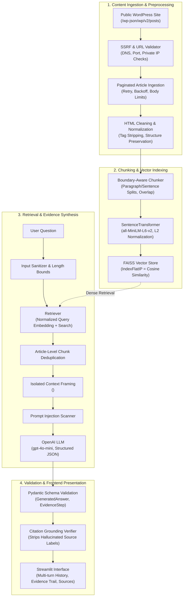

# RAG_COT_Model — Explainable Evidence-Grounded Assistant

A production-ready Retrieval-Augmented Generation (RAG) application engineered to ingest public articles from WordPress REST APIs, index them using dense embeddings in FAISS, retrieve relevant passages via exact cosine similarity, and generate explainable, evidence-grounded responses with verifiable citations.

---

## 1. Project Overview & Problem Statement

Traditional chatbot applications often hallucinate, cite outdated facts, or fail to substantiate their claims with verifiable sources. In corporate and publishing workflows where articles are hosted on content management systems, teams require a system that can:
1. Ingest public posts dynamically without requiring custom plugins or database access.
2. Segment long articles into coherent chunks while preserving critical context boundaries.
3. Retrieve semantically relevant passages efficiently and without bias.
4. Synthesize answers strictly grounded in retrieved evidence, explicitly flagging uncertainty or missing information.
5. Provide user-facing evidence steps and citations that allow human operators to verify every claim against the original sources.

`RAG_COT_Model` achieves this through a modular, secure, and fully explainable pipeline.

---

## 2. System Architecture

The following diagram illustrates the complete logical pipeline and layered security boundaries:



---

## 3. Technology Stack

- **Primary Language:** Python 3.10+ (tested on Python 3.12)
- **Frontend / Application Framework:** [Streamlit](https://streamlit.io/)
- **Embedding Model:** [Sentence-Transformers](https://sbert.net/) (`sentence-transformers/all-MiniLM-L6-v2`, 384 dimensions)
- **Vector Database:** [FAISS CPU](https://github.com/facebookresearch/faiss) (`IndexFlatIP` with L2-normalized vectors)
- **Generation LLM:** [OpenAI API](https://platform.openai.com/) (`gpt-4o-mini` with structured JSON output)
- **HTML Parsing & Cleaning:** BeautifulSoup4 & Python standard library `html`
- **Validation & Typing:** Pydantic v2
- **Testing & Verification:** Pytest

---

## 4. Pipeline & Methodology

### A. Content Ingestion & SSRF Protection
- Ingests public articles directly through WordPress's standard REST API endpoint (`/wp-json/wp/v2/posts`).
- Features a strict **SSRF validator** that resolves hostnames before making network calls, rejecting private IP ranges (`10.0.0.0/8`, `172.16.0.0/12`, `192.168.0.0/16`), loopbacks (`127.0.0.0/8`, `::1`), link-local/cloud metadata (`169.254.169.254`), and non-standard ports.
- Supports pagination, custom article counts, rate-limit backoff (429 handling), and body size ceilings (15 MB).

### B. Preprocessing & HTML Cleaning
- Strips non-content boilerplate: `<script>`, `<style>`, `<nav>`, `<iframe>`, and structural noise.
- Preserves paragraph transitions (`\n\n`) and headings so text retains natural discourse structure.
- Fixes orphaned punctuation and normalizes redundant whitespace.

### C. Chunking & Overlap Strategy
- Configurable chunk size (default: 900 characters) and overlap (default: 150 characters).
- Boundary-aware splitting prefers paragraph endings (`\n\n`), sentence terminators (`.`, `!`, `?`), and whitespace over arbitrary mid-word slicing.
- Preserves full provenance metadata with each chunk: `post_id`, `chunk_id`, `title`, `url`, `date`, and `source`.

### D. Embeddings & Cosine Search via FAISS
- Each chunk text is encoded with `sentence-transformers/all-MiniLM-L6-v2`.
- Vectors are L2-normalized:
  $$\|\mathbf{v}\|_2 = 1 \implies \mathbf{u} \cdot \mathbf{v} = \cos(\theta)$$
- FAISS `IndexFlatIP` computes the inner product directly over normalized vectors, delivering exact cosine similarity without distance distortions.
- Query vectors are normalized with the identical pipeline.
- Index and metadata can be saved and loaded with checksum validation ensuring version parity.

### E. Explainability & Evidence Presentation
- The application presents concise, verifiable **evidence steps** showing:
  - Which facts were retrieved.
  - Which source passages support each claim.
  - Where evidence remains insufficient.
- Responses strictly follow the validated schema:
  ```json
  {
    "answer": "Grounded answer text.",
    "evidence_steps": [
      {
        "explanation": "Specific factual summary supported by the cited article.",
        "source_ids": ["S1"]
      }
    ],
    "used_sources": ["S1"],
    "insufficient_evidence": false
  }
  ```
- Hallucinated or non-existent source references are automatically detected and stripped before display.

---

## 5. Security & Prompt Injection Guardrails

1. **Untrusted Data Isolation:** Retrieved articles are framed in XML tags (`<untrusted_retrieved_context>`) with strict instructions to the LLM to treat them solely as passive data.
2. **Injection Detection:** User inputs and retrieved content are scanned for adversarial patterns (`ignore previous instructions`, `reveal system prompt`, `exfiltrate`).
3. **No Tool Execution:** The LLM cannot execute shell commands, Python code, or arbitrary HTTP requests.
4. **Secret Masking:** Application loggers automatically redact API keys and bearer tokens.
5. **Session Isolation:** Conversation states are maintained exclusively in `st.session_state` per user session.
6. **XSS Protection:** All text rendered in Streamlit is HTML-escaped.

For detailed security information, see [SECURITY.md](SECURITY.md).

---

## 6. Installation & Local Setup

### Prerequisites
- Python 3.10, 3.11, or 3.12
- Git

### 1. Clone the Repository
```bash
git clone https://github.com/Lemniscate-2525/RAG_COT_Model.git
cd RAG_COT_Model
```

### 2. Create and Activate Virtual Environment
```bash
# Windows
python -m venv .venv
.venv\Scripts\activate

# macOS / Linux
python3 -m venv .venv
source .venv/bin/activate
```

### 3. Install Dependencies
```bash
pip install -r requirements.txt
```

### 4. Configure Environment Variables
Copy the template configuration:
```bash
cp .env.example .env
```
Edit `.env` to provide your OpenAI API key:
```env
OPENAI_API_KEY=sk-proj-your-actual-api-key-here
OPENAI_MODEL=gpt-4o-mini
DEFAULT_WORDPRESS_URL=https://techcrunch.com
```
*(Note: If `OPENAI_API_KEY` is not provided, the application automatically runs in a fully functional Retrieval-Only Mode).*

### 5. Launch the Streamlit Application
```bash
streamlit run app.py
```
Open your browser at `http://localhost:8501`.

---

## 7. Evaluation Framework

The repository includes a comprehensive retrieval and generation evaluation harness.

### Metrics Computed:
- **Hit Rate@K:** Proportion of queries where at least one relevant post is retrieved in the top-K.
- **Recall@K:** Proportion of all known relevant posts retrieved in the top-K.
- **Mean Reciprocal Rank (MRR@K):** $1 / \text{rank}$ of the first relevant article.
- **nDCG@K:** Normalized Discounted Cumulative Gain accounting for rank positions.
- **Post-Level Deduplication:** Multiple chunks belonging to the same post are collapsed to avoid artificially inflating metrics.
- **Generation Faithfulness:** Citation precision and lexical context grounding score.

### Running Evaluation
```bash
python evaluate_rag.py --dataset evaluation/dataset/eval_dataset.json --site https://techcrunch.com --pages 2 --k 3
```

---

## 8. Automated Testing

The project includes unit, integration, and security tests:
- HTML cleaning & script stripping
- Text chunking & boundary preservation
- Embedding normalization & dimensionality
- FAISS exact retrieval & deduplication
- Index persistence & checksum validation
- Pydantic schema validation & citation scrubbing
- SSRF prevention (private IPs, loopback, link-local, non-standard ports)
- Prompt injection detection heuristics
- End-to-end smoke test

Run the test suite:
```bash
pytest tests -v
```

---

## 9. Deployment to Streamlit Community Cloud

The application is structured for instant deployment to Streamlit Community Cloud:

1. **Push your changes to GitHub** on the `main` branch.
2. Sign in to [Streamlit Community Cloud](https://share.streamlit.io/).
3. Click **"New App"** and select:
   - **Repository:** `Lemniscate-2525/RAG_COT_Model`
   - **Branch:** `main`
   - **Main file path:** `app.py`
4. In **Advanced Settings → Secrets**, configure:
   ```toml
   OPENAI_API_KEY = "sk-..."
   OPENAI_MODEL = "gpt-4o-mini"
   ```
5. Click **Deploy**. Streamlit Cloud will install dependencies from `requirements.txt` and launch the application.

---

## 10. Repository Structure

```text
RAG_COT_Model/
│
├── app.py                     # Streamlit frontend & session coordinator
├── config.py                  # Typed configuration & secret loader
│
├── ingestion/                 # Content ingestion & parsing
│   ├── __init__.py
│   ├── wordpress.py           # WordPress REST API client (pagination, retries)
│   ├── preprocessing.py       # HTML cleaning & structural preservation
│   └── url_validator.py       # Strict SSRF defense & DNS resolution checks
│
├── retrieval/                 # Retrieval & vector indexing
│   ├── __init__.py
│   ├── chunking.py            # Sentence & paragraph boundary chunking
│   ├── embeddings.py          # SentenceTransformer L2-normalized embeddings
│   ├── vector_store.py        # FAISS IndexFlatIP cosine similarity store
│   └── retriever.py           # Top-K ranking & article deduplication
│
├── generation/                # Grounded generation & explainability
│   ├── __init__.py
│   ├── models.py              # Pydantic schemas (GeneratedAnswer, EvidenceStep)
│   ├── prompts.py             # Versioned system prompt & context delimiters
│   ├── guardrails.py          # Injection scanner & citation grounder
│   └── llm.py                 # OpenAI structured generation & fallback
│
├── evaluation/                # Evaluation benchmarks
│   ├── __init__.py
│   ├── metrics.py             # Hit Rate@K, Recall@K, MRR@K, nDCG@K, Faithfulness
│   ├── evaluate_rag.py        # CLI evaluation runner
│   └── dataset/
│       └── eval_dataset.json  # Labelled evaluation test cases
│
├── utils/                     # Cross-cutting utilities
│   ├── __init__.py
│   ├── exceptions.py          # Domain-specific exceptions
│   └── logging_config.py      # Secret-masking structured logger
│
├── tests/                     # Test suite (30 passing tests)
│   ├── test_ingestion.py
│   ├── test_preprocessing.py
│   ├── test_chunking.py
│   ├── test_embeddings.py
│   ├── test_retrieval.py
│   ├── test_generation.py
│   ├── test_security.py
│   ├── test_evaluation.py
│   └── test_e2e.py
│
├── .streamlit/
│   └── config.toml            # Streamlit theme & performance settings
├── .env.example               # Environment variables template
├── .gitignore                 # Exclusion rules for secrets, cache, indexes
├── requirements.txt           # Pinned production dependencies
├── SECURITY.md                # Comprehensive security & threat model document
└── README.md                  # System documentation
```

---

## 11. Known Limitations & Future Roadmap

- **Vector Persistence on Ephemeral Cloud:** On ephemeral hosting like Streamlit Community Cloud, FAISS indexes reside in session memory and must be fetched/rebuilt if the container restarts.
- **Lexical Search (BM25):** The current implementation uses dense vector embeddings; integrating hybrid sparse-dense retrieval (e.g. BM25 + FAISS) with a cross-encoder reranker would enhance keyword precision for rare domain terminology.
- **Incremental Sync:** Re-indexing currently processes selected batches; an incremental change-detection mechanism using WordPress `modified` timestamps could further reduce network traffic.

---

## 12. License

This project is licensed under the MIT License.
